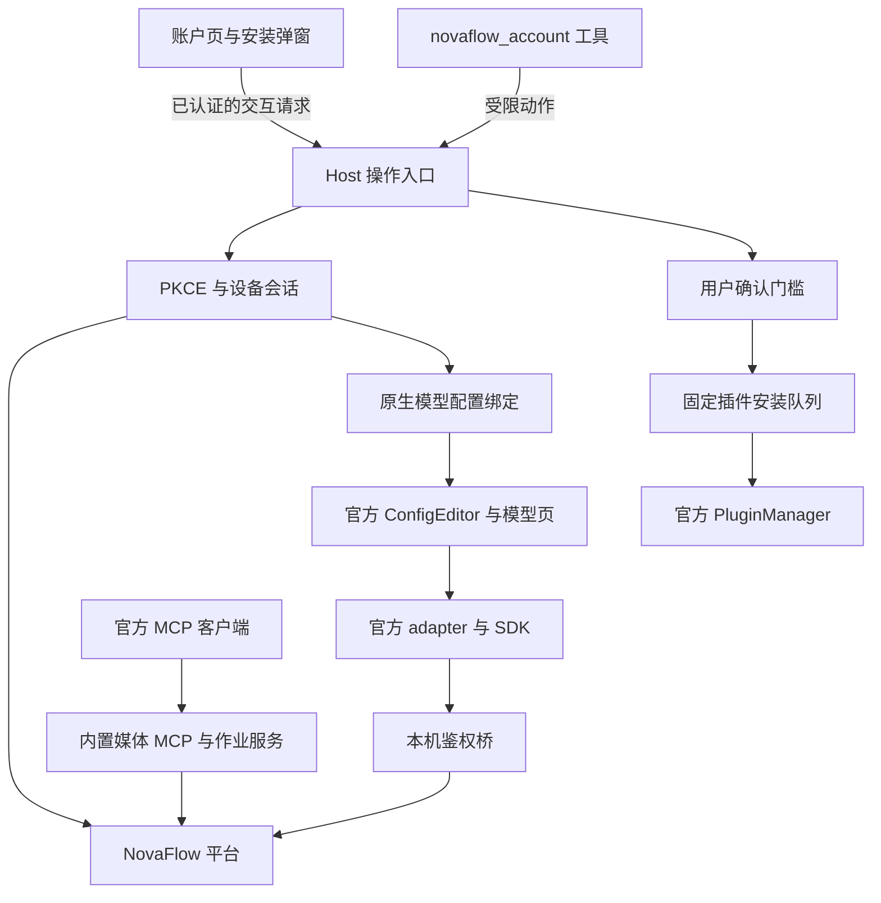
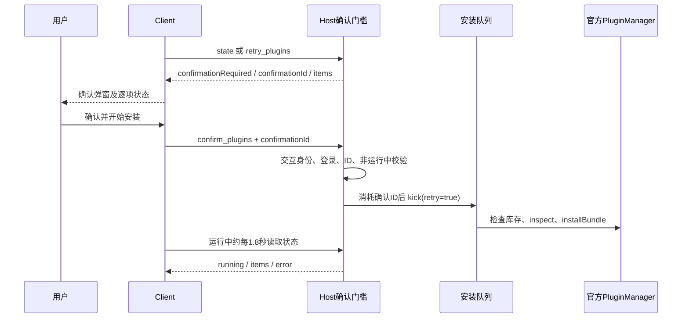

# NovaFlow 插件开发手册

适用：插件 2.6.0，DSH 0.2.2-rc.2／0.2.2-rc.3，Node.js ≥24。本文描述当前实现，功能入口见[使用说明](../README.md)，测试与分发见[测试与发布](RELEASE.md)。

## 1. 项目边界与依据

本项目是通过官方 PluginManager 安装到当前 profile 的 Host／Client bundle，不修改 DSH 应用安装文件。包名为 `@local/novaflow-dsh-plugin`，Host 插件名为 `novaflow-account`。清单和入口见[包清单](../package.json)、[Host 入口](../index.js)、[Client 入口](../client.js)、[加载补丁](../cordis.patch.yml)。

平台契约依据 NovaFlow 平台内部的《35 创作工作台登录与凭据》专题。该内部文档不随公开仓库分发；接入实现和必要协议摘要见下文，平台契约变更由维护者对照内部文档核对。

平台文档中的旧桌面客户端已归档说明，不代表本独立插件停止维护。平台接口存在也不代表本插件已集成全部接口：例如本插件不取得 `/creator/content/credential` 的共享内容凭据。2.6.0余额采用平台 New API 既有的 `/plugin/usage` 设备接口，无需修改后端；它不是标准 dashboard billing 端点，具体契约见下文。

DSH API 以当前安装的运行时 Inspect 与官方源码为准。需要新接口时先调用 `cordis_inspect_list`，再按返回的 provider、method 和 schema 查询；Inspect 仅提供只读契约，不能把 Inspect 方法当作业务 Service 使用。此次配置表已与实时 `Config.listConfigs` 核对。

## 2. 架构与源码地图

| 文件 | 职责与修改时应关注的边界 |
|---|---|
| [Host 入口](../index.js) | 注入服务、配置、HTTP／工具动作、回调、定时刷新和清理 |
| [Client 入口](../client.js) | 动态模块、账户视图、安装弹窗、共享状态与轮询、中英字典 |
| [协议层](../src/protocol.js) | 固定发行方、请求封装、令牌形状与回调地址校验、安全错误码 |
| [账户状态机](../src/account.js) | PKCE、取消、回调、轮换、退出和撤销 |
| [原生模型绑定](../src/native-models.js) | 读取随 DSH 分发的库、官方配置写入、受管归属及用户编辑保留 |
| [模型桥](../src/model-bridge.js) | 本机连接鉴权、动态设备凭据、分组及协议转发、流式响应 |
| [确认门槛](../src/plugin-install-flow.js) | 交互身份、一次性确认 ID、登录提醒与重试请求 |
| [安装队列](../src/plugin-bootstrap.js) | 固定清单、库存、镜像检查、官方安装、状态持久化与恢复 |
| [包运行时预检](../src/package-runtime.js) | Windows Desktop 内置 pnpm 存在与版本启动检查 |
| [媒体 MCP](../src/media-mcp.js) | Streamable HTTP、工具 schema、鉴权与协议响应 |
| [媒体作业服务](../src/media-service.js) | 模型和分组选择、生成、轮询、结果文件及持久作业恢复 |
| [分发诊断](../src/release.js) | 发布版本、安装流程标识、真实客户端 revision 与资源地址 |
| [中文资源](../locale/zh.json)、[英文资源](../locale/en.json) | 与 Client 内嵌字典保持一致，由分发契约测试校验 |

## 3. Host 配置与服务

配置由 `Schema` 的默认导出构建，应用时要求 `maxTokens < contextWindow`。保存配置通过官方编辑能力完成，不手工改写 profile 文件。

| 字段 | 默认值 | 范围与语义 |
|---|---|---|
| `autoInstallPlugins` | `true` | 登录／恢复登录后提醒确认。名称保留兼容；不授予无确认安装权限 |
| `enableAllCapabilities` | `true` | 首次能力启用沿用图片／思考开关语义，协议按模型家族选择；策略迁移后保留原生编辑。`migrate_protocols`不重置能力，`configure_models`显式重新启用 |
| `contextWindow` | `32768` | 8192～1048576；缺少已知模型元数据时的上下文预算 |
| `maxTokens` | `4096` | 1024～131072，并小于上下文预算；初始化时的输出上限参数 |
| `modelsRefreshInterval` | `600000` | 60000～3600000 毫秒；仅已连接时定时刷新 |

Host 必需注入 `credentials`、`connection`、`webServer`、`llm`、`agentDefaultModel`、`tools`、`configEditor`、`mcpManager`、`workingDirectory`、`pluginManager`、`storageDomain`。可选的 `clientModules` 用于分发诊断，不应作为登录前置条件。

Client 使用 `window.__ModuleLoader__.load` 注册动态模块，注入 `slots`、`locale`，通过运行时加载 React。主要 Slot 为 `settings.section`、`settings.launcher`、`settings.models.sign-in`、`settings.models.footer` 与 `shell.overlay`；安装弹窗 ID 是 `novaflow-plugin-install-confirmation`。

## 4. 本机接口与调用权限

| 入口 | 用途与限制 |
|---|---|
| POST `/api/novaflow-account` | 通过 Connection 认证，要求 owner 且 `interactions=answer`；JSON 请求，只接受 `action`、可选 `attemptId`、可选 `confirmationId`，正文最多4096字符 |
| GET `/novaflow/callback` | 浏览器授权回调；核对 Host、当前 state、发行方、期限和登录代次 |
| `/novaflow/models/<provider>` 前缀 | 本机模型桥；独立本机凭据，按受管路由限定模型、协议和分组 |
| POST `/novaflow/magpie-image/mcp` | 回环 Streamable HTTP MCP；独立 Bearer、本机来源和 Host 校验 |

账户 HTTP 成功响应为 `{ok:true,value:...}`，业务失败为 `{ok:false,error:{code:...}}`。认证失败为403，非 JSON 为415，操作错误通常为400。不能把某个 HTTP200 或浏览器完成跳转单独当作已连接证明。

| 动作 | 交互 HTTP | `novaflow_account` 工具 | 作用 |
|---|---|---|---|
| `state` | 是 | 是 | 脱敏账户、余额、原生配置摘要、媒体状态、安装状态与分发信息；只读 Host 当前状态 |
| `refresh` | 是 | 是 | 刷新会话／目录，随后非阻塞刷新余额，不开始安装 |
| `refresh_balance` | 是 | 是 | 单独发起平台余额读取，不刷新模型目录或触发安装 |
| `cancel` | 是，可带 `attemptId` | 是，无 attempt 参数 | 取消当前待授权过程；交互侧用 attempt ID 防止取消错代次 |
| `signout` | 是 | 是 | 清理本机登录，尝试撤销当前设备 |
| `configure_models` | 是 | 是 | 显式重新应用家族协议，并重新启用text/image输入和协议原生思考档位 |
| `migrate_protocols` | 是 | 是 | 一次迁移旧受管协议，保留已有图片／思考设置语义；可离线编辑已保存受管配置，不发布缓存桥权限 |
| `retry_plugins` | 是 | 是 | 重新请求用户确认，不开始安装 |
| `start` | 是 | 否 | 发起浏览器登录 |
| `confirm_plugins` | 是，必须带当前确认 ID | 否 | 核验交互请求后启动固定安装队列 |

工具 schema 不接收任意包名、令牌或确认 ID。开发排查不得通过扩展工具权限来代替用户点击。

## 5. 登录、凭据与原生模型

平台固定为 `https://www.ycnovaflow.vip`，账户 API 前缀为 `/api/novaflow/v1`。每次登录生成独立 verifier／state，用 `client_id=novaflow-creator` 和 S256 发起请求；仅接收 `http://127.0.0.1:<port>/novaflow/callback`。浏览器展示平台授权页，由用户批准后换码，再读取创作身份和目录。

设备访问令牌最长900秒。刷新必须串行，先持久化刷新进行中标记，再原子替换令牌；网络结果未知时不能重放旧 refresh，平台会因重放撤销设备。恢复未知刷新状态时，若仍有旧凭据，须在账户与余额中先退出清除旧设备凭据，再重新登录；否则 `start()` 返回 `SIGNOUT_REQUIRED`。退出保留原生提供商和模型配置。

| 数据 | 保存位置／所有权 |
|---|---|
| 设备访问／刷新令牌及会话 | DSH Credentials 记录 `novaflow-account/creator`，不进入 Client 或模型配置 |
| 原生提供商受管归属 | Credentials 记录 `novaflow-account/native-providers` |
| 统一配置偏好与登录前默认模型 | Credentials 记录 `novaflow-account/model-preferences`、`novaflow-account/default-model` |
| 模型桥独立凭据 | 按提供商创建的 Credentials 引用；受管归属记录校验摘要，防止删除用户替换的密钥 |
| MCP 本机连接凭据 | Credentials 名称 `NOVAFLOW_IMAGE_MCP_KEY` |
| 安装结果与 request ID | StorageDomain `novaflow_plugin_bootstrap`，version 1；无设备令牌 |
| 媒体作业元数据 | 默认工作目录的 `.novaflow-media/jobs/`；无平台凭据 |

仅 `kind=text` 的授权目录进入 DSH 模型提供商。名称默认采用原始模型ID，不加分组后缀；请求继续按授权group路由，不能仅凭显示名判断路由相同。`protocolForModel`不区分大小写地识别原始ID开头及常见vendor前缀后的Claude（支持斜杠、冒号、点等边界）；Claude选择 `anthropic-messages`，其他文本模型选择 `openai-responses`。

历史source提供商标识保留，纯家族source原地更新api和本机URL；混合source按家族拆出确定性child，受管归属记录 `sourceProvider` 与 `familyApi`。原生名称、容量、删除记录和 `modelOverrides` 按家族分配，不重新添加用户删除的模型。默认选择若指向迁移模型则跟随到新提供商；已有会话的显式引用不批量改写，引用被拆走模型的会话需重新选择。

原生模型编辑、发现、思考选择和请求序列化属于官方 `llm-pi-ai`、adapter 与 SDK。插件通过 `ctx.configEditor.edit()` 保存连接，并在桥中附加当前设备访问凭据和 `X-NovaFlow-Group: encodeURIComponent(group_id)`；桥不重写 SDK 生成的模型正文。

受管归属与偏好记录使用 `protocolPolicy='claude-messages-v2'` 标记一次家族迁移。成功后普通刷新保留后续原生协议和能力编辑；跨协议转换清理不适用的compat。Responses显式能力配置为 `input=['text','image']` 与 `off→none`、`low`、`medium`、`high`、`xhigh`、`max`；Claude的reasoning取随附官方metadata，`off→null`，不直接套用Responses的none/xhigh，仅保留官方metadata允许的值（部分Claude支持xhigh），不额外宣称adaptive。未知Claude的 `reasoningEfforts=false`。

首次启用能力保持既有开关语义。`migrate_protocols`仅转换尚未应用策略的旧协议，保留图片开关和已关闭思考；已知Claude保留官方metadata支持的自定义档位有效子集，非Claude也保留有效自定义档位子集，不自动扩展，off的none／null按目标协议转换。该动作标记能力初始化已处理，避免下次联网刷新重置既有input／reasoning。`configure_models`则显式重新启用图片与协议原生档位。两者都不保证上游实际支持所有客户端选项。

离线迁移从已保存原生配置和受管归属构造迁移计划，通过官方ConfigEditor保存，不要求重新授权；离线不会把cached目录权限发布给bridge，配置迁移成功不代表已连接或能发请求。用户改作其他连接后停止管理该连接。退出保留原生配置，清理插件仍拥有的连接凭据，并按归属恢复默认模型。

### New API 余额契约

余额请求为 `GET https://www.ycnovaflow.vip/api/novaflow/v1/plugin/usage`，使用当前 `nfds_` 设备 access token 作为 Bearer；不使用网页登录 Cookie、PAT 或后台模型 Key，不改后端。标准 `/v1/dashboard/billing/subscription` 和 `/v1/dashboard/billing/usage` 不接受 creator 令牌且不适用于企业钱包，不能把本实现称为调用标准 billing 端点。

| 字段 | 语义与展示规则 |
|---|---|
| `schema_version` | 当前为 `1`；按契约校验响应 |
| `account_mode` | `personal` 或 `enterprise`；选择对应钱包并区分个人／公司共享余额 |
| `personal`／`company` | 对应身份的钱包对象，含 `balance`、`frozen`、`available`；均为 CNY decimal 字符串，服务端已完成换算 |
| `limits` | `null` 或成员日／月限额、`used`、`remaining`、`canUse`；成员额度不是公司钱包总额，null／不限额不能转成0 |
| `as_of` | 服务端更新时间；与旧数据提示一起展示，不能用本地轮询时间冒充余额更新时间 |

客户端主显 `available`，同时展示总额和冻结；金额不再除以 `QuotaPerUnit` 或乘汇率。`canUse=false` 提示成员额度限制，不能据此推断公司钱包没有余额。Host `state` 包含余额状态，供界面和 Agent 读取；`refresh_balance` 才发起独立余额请求。

登录成功、账户刷新和默认每10分钟的后台目录刷新后，非阻塞读取余额。界面约1.8秒的轮询仅查询本机 Host 当前状态，不能在轮询中反复调用平台。余额失败不破坏模型登录或目录同步；公开状态与界面保留 error／unavailable，已成功数据保留并明确标旧，无数据不显示假0。退出、授权拒绝、身份切换与卸载时清理相关状态和在途工作，晚到结果须校验身份／代次，不能让旧余额复活。

当前 `AUTH_REQUIRED` 状态不能提供真实在线余额证据。必须由用户重新授权后，对照平台个人／企业钱包现场核验金额与更新时间；隔离测试、Client资源和Slot注册不替代该验收。

## 6. 安装确认与队列

必须保留以下约束：

- 登录、initialize、callback、账户刷新和状态读取只提供安装机会，不调用安装队列。`autoInstallPlugins=false` 关闭登录提醒，仍可由用户手动打开并确认。
- 当前确认 ID 只能接纳一次；非交互、未登录、旧 ID 和重复运行分别拒绝。确认 ID 不是平台凭据，也不能替代 Connection 认证。
- 固定目标为 `dshmarket`、`dsh-ops`、`dsh-free-search`、`@michengai/dsh-archive-manager`、`dsh-rewind-plugin`；首选 registry 为 `https://registry.npmmirror.com`。
- `listBundles()` 和 `listPlugins()` 都按异步结果等待。检查包名、明确版本与 bundle 身份后，调用官方 `installBundle`，传 `saveExact`、`requestId`、`expected`，不执行 shell 安装到 profile。
- 已安装项跳过，已禁用项保持禁用，不自动升级、不批准脚本、不创建版本豁免、不自动重启。
- 构造时将保存的 `running` 重置为 false。中断记录只有在新的用户确认后才通过 `waitForInstall(requestId)` 恢复，不因插件重载自动续装。
- 关闭弹窗不开始安装；安装已接纳后关闭弹窗不取消官方安装。退出／卸载停止后续队列，不能声称已取消官方管理器接纳的工作。

全局状态为 `attempted`、`running`、`registry`、`items`、可选 `error`；确认层追加 `confirmationRequired`、`confirmationId`。条目可包含 `version`、`code`、`requestId` 和 `pendingBuilds`。主要状态是 `pending`、`checking`、`installing`、`installed`、`already-installed`、`present-disabled`、`restart-required`、`failed`、`overridden`，并保留平台不支持分支。

Windows Desktop 预检使用应用 resources 下 `runtime/primary-runtime/dependencies/pnpm/bin/pnpm.mjs`，由应用自带可执行程序以参数数组和 `ELECTRON_RUN_AS_NODE=1` 执行 `--version`。全部目标已存在时无需预检。预检不下载运行时、不改 PATH；非 Windows／无 Desktop resources 的环境交由官方安装器处理。

## 7. 媒体 MCP 与作业

内置服务提供 `generate_image`、`generate_video`、`generation_result`、`list_models`，经官方 MCP 客户端形成 `mcp__magpie-image__*` 工具名。图片省略 model 时使用原始 ID `gpt-image-2.6`；视频 schema 要求 model，模型必须是用户的明确选择。同名模型跨组时要明确 group，避免擅自选择计费路由。

长任务返回 ID 后查询原作业。提交结果未知时不自动重提；重启恢复依据元数据及结果哈希判断。默认输出到默认工作目录的 `generated-images/` 和 `generated-videos/`；相对 path 和参考图也按默认工作目录解析，不跟随其他会话 cwd。

路径不得越出该目录或穿过符号链接，提交前检查输出冲突。外部 HTTPS 图像下载校验公共地址并固定已校验 DNS 结果。退出／卸载中止本机工作；这不等于上游已经停止计费任务。

## 8. 生命周期与界面交付

账户初始同步通过下一轮事件循环延后到 apply 返回后执行。官方 ConfigEditor 和 PluginManager 可能持有 HMR 锁，不能在 apply／dispose 中等待自己触发的重载完成。dispose 不等待安装 Promise；晚到配置、凭据写入和网络结果需校验当前 generation／revision，防止退出后复活旧状态。

新增资源统一由 `ctx.effect` 注册清理，包括路由、定时器、监听器、MCP 和回环请求。Client 使用共享状态；授权待处理或安装运行中轮询，卸载清理计时器。弹窗需保留 Escape、焦点循环、焦点恢复、busy 禁用和双主题 token。

修改本地源码或版本号后，还需确认正在访问的 GUI 实际加载了新资源。用 `delivery` 提供的地址检查响应，再用实时 Slot 核对注册；仅检查磁盘文件或 Host 版本不够。Client 无刷新更新依赖同一 checkout 的 `pnpm run dev:web` watcher，不能未经核实承诺 HMR。完整步骤见[测试与发布](RELEASE.md)。
